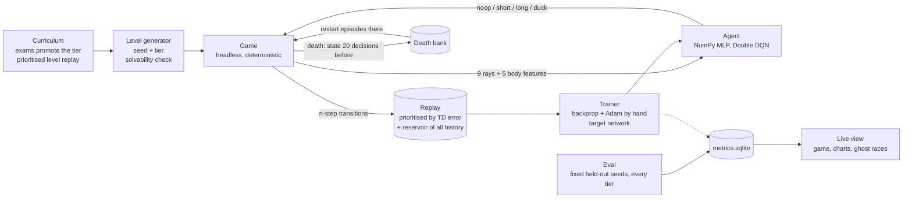

# endless-learner

A small game and an agent that learns it from its own failures, training forever on a laptop CPU. Every death becomes training data, the game gets harder as the agent gets better, and a live page shows it learning. The game, the neural network, backpropagation, the optimiser and the reinforcement learning are written from scratch on NumPy: no PyTorch, no Gym, no pretrained weights.

## How it works



**The game.** A side-scrolling runner. Each level is a pure function of a tier and a seed: low and tall blocks, gaps, overhangs to duck under, blocks that slide towards the agent, and from tier 5 on, tight combinations of them. The agent can do nothing, jump short, jump long or duck. Tiers have no top: speed, density and the obstacle mix keep turning up until they reach caps set by the physics. Every level is checked solvable before it is handed out, by a depth-first search over jump timings that runs on the same physics code as the game, so no death is the level's fault.

**What the agent sees.** Nine rays fan out from the front of its body. Each reports the distance to the first hit, what was hit (ground, pit, block, overhang) and how fast that distance is closing, which is how a moving block shows up. Five more numbers describe the agent: height, vertical speed, on the ground, ducking, scroll speed. No pixels, so a two-layer MLP is enough and it trains on a CPU.

**Learning from failure.**

- *Prioritised replay* (Schaul et al., 2016). Transitions are replayed in proportion to their last TD error, with importance weights to correct the bias. The run logs |TD| on transitions just before a death against routine ones, which shows whether replay focuses where it should.
- *The death bank.* Every death saves the game state from 20 decisions earlier. A quarter of episodes restart from one of those states, so the agent practises the exact situation that killed it (the idea of "first return, then explore", Ecoffet et al., 2021, and reverse curriculum generation, Florensa et al., 2017). An entry counts as fixed after two passes in a row; the attempts that took are logged.
- *Death signatures.* Each death is labelled by cause and posture: `overhang/air` is jumping into an overhang, `gap/ground` is running into a gap.

**Never stopping.**

- *Exams drive the curriculum.* 30% of fresh levels at the current tier are played with no exploration, and only those count for promotion: with 3% random actions per decision, exploring episodes die often enough to hide how good the policy is. Promotion at 80% over 50 exams, demotion under 20%.
- *Prioritised level replay* (Jiang et al., 2021) inside a tier: seeds whose last episode had a high mean TD error come back more often.
- *Against forgetting:* 15% of episodes replay a passed tier, and a reservoir sample over the whole history (25% of every batch) keeps old transitions in training after the ring buffer has overwritten them.
- *Against plasticity loss:* the run tracks dead units, feature rank (srank, Kumar et al., 2021) and weight norm. `--cbp` turns on continual backprop (Dohare et al., 2024), which replaces a trickle of the least useful hidden units with fresh ones.

**Running forever.** One process with NumPy capped to one thread. Fixed-size buffers, so memory stays flat. A checkpoint of everything (weights, optimiser, replay, death bank, curriculum, RNG state) every 5 minutes, written atomically; starting `train` on the same folder resumes exactly, and metrics logged after the last checkpoint are dropped and counted as lost. Time is counted in active hours, with gaps capped, so a sleeping laptop doesn't count. A hall-of-fame snapshot of the weights every active hour.

## Decisions and trade-offs

- **Double DQN, not PPO.** Learning from failure means going back to old experience. Off-policy replay does that; on-policy methods use each transition once and throw it away.
- **Rays, not pixels.** Pixels would need convolutions and far more compute. Rays carry what matters (distance, type, closing speed) and work on any generated level.
- **NumPy, not a framework.** Every gradient is written out and checked against central differences (`python -m endless gradcheck`, max relative error around 1e-8). The cost is speed: 1,400 to 1,900 environment steps per second on one core of an i7-1265U, with a learning update every 4 steps.
- **Two ticks per decision.** Halves the number of decisions per level, which makes credit assignment easier, at no cost in control: jumps last 10 to 15 decisions.
- **Promotion on exams, not training episodes.** See above. The held-out evaluation seeds never drive training: they are only measured.
- **A solvable-level guarantee.** Generation retries until the solver finds a plan, which gets slow at high tiers (tens to hundreds of milliseconds per level beyond tier 15). Levels are cached and replayed seeds are common, so it stays a small share of the time.

## KPIs

Every number comes from the run's `metrics.sqlite` and `python -m endless report`:

| Group | What is measured |
|-------|------------------|
| Learning | Frontier tier (highest tier with at least 80% of held-out levels passed), progress and success per tier, steps to reach each tier, comparison with a random and a rule-based player |
| Learning from failure | Deaths per exam by signature over time, death-bank pass rate, attempts to fix a failure, |TD| near deaths against routine |
| Never stops | Forgetting per tier (best held-out success minus current), backward transfer, train-seed against held-out gap, hall-of-fame races, dead units, srank, weight norm, NaN recoveries |
| Systems | Steps and updates per second, CPU, RAM over time, resumes and steps lost per resume, checkpoint size and time |

Baselines on 10 held-out levels per tier (`python -m endless baseline`): a random player never finishes a level at any tier. The rule-based player, which reads the level directly and times every jump to centre its arc over the next obstacle, finishes every level up to tier 4, and falls apart once combinations appear (60% at tier 5, 30% at tier 6, 0 to 20% from tier 7).

## Run it

Python 3.10+ and NumPy.

```
pip install numpy
python -m endless train --run runs/main
```

Open http://127.0.0.1:8765 for the live view: the agent playing a held-out level with its rays drawn, the charts above, and ghost races between any two hall-of-fame snapshots on the same level.

| Command | What it does |
|---------|--------------|
| `python -m endless train --run runs/main` | Train, or resume if the folder has a checkpoint. `--max-hours`, `--max-steps` to stop on their own. |
| `python -m endless stop --run runs/main` | Stop cleanly from another terminal: checkpoint, then exit. Ctrl+C does the same. |
| `python -m endless view --run runs/main` | The live view on its own, for a run that is training in another process or has finished. |
| `python -m endless report --run runs/main` | Every KPI. `--hof` also races the newest snapshot against each older one. |
| `python -m endless baseline` | Random and rule-based players on the held-out levels. |
| `python -m endless eval --run runs/main --net h0012` | Any snapshot on the held-out levels. |
| `python -m endless gradcheck` | Backprop against numerical gradients. |
| `python -m unittest discover -s tests -t .` | Tests: physics, solver plans replayed in the environment, rays, sum tree, n-step returns, checkpoint and exact resume. |

Ablations are flags on `train`: `--no-per`, `--no-restarts`, `--no-curriculum --fixed-tier 6`, `--no-reservoir`, `--no-old-tiers`, `--no-plr`, and `--cbp` to add continual backprop. Use a separate `--run` folder for each.

Keeping it running is up to you: plug the laptop in, stop it from sleeping, and start `train` again after a reboot. It carries on where it stopped.

## Limitations

- One game, and a small one. Rays make the problem much easier than learning from pixels.
- Single-threaded NumPy is slow next to a GPU framework. The point is that every piece is visible, not speed.
- "Forever" is bounded by the physics: past some tier the generator can't make harder solvable levels, and the knobs sit at their caps.
- Death signatures are coarse on purpose (cause and posture), so they count types of failure, not individual situations. The death bank is where individual situations are tracked.

## References

Mnih et al., "Human-level control through deep reinforcement learning", Nature 2015. van Hasselt, Guez and Silver, "Deep Reinforcement Learning with Double Q-learning", AAAI 2016. Schaul et al., "Prioritized Experience Replay", ICLR 2016. Ecoffet et al., "First return, then explore", Nature 2021. Florensa et al., "Reverse Curriculum Generation for Reinforcement Learning", CoRL 2017. Jiang, Grefenstette and Rocktäschel, "Prioritized Level Replay", ICML 2021. Cobbe et al., "Leveraging Procedural Generation to Benchmark Reinforcement Learning", ICML 2020. Dohare et al., "Loss of plasticity in deep continual learning", Nature 2024. Lyle et al., "Understanding plasticity in neural networks", ICML 2023. Kumar et al., "Implicit Under-Parameterization Inhibits Data-Efficient Deep Reinforcement Learning", ICLR 2021. Kirkpatrick et al., "Overcoming catastrophic forgetting in neural networks", PNAS 2017. Chaudhry et al., "Riemannian Walk for Incremental Learning", ECCV 2018. Lopez-Paz and Ranzato, "Gradient Episodic Memory for Continual Learning", NeurIPS 2017. Kingma and Ba, "Adam", ICLR 2015.

## License

MIT
